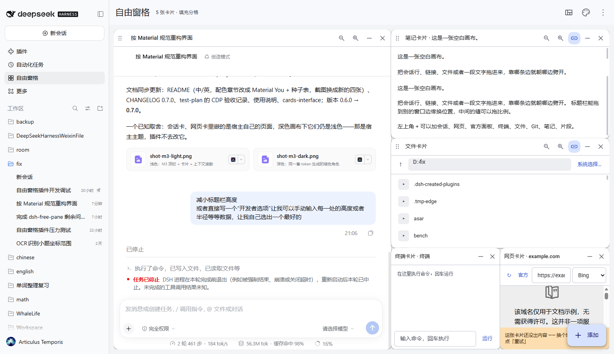
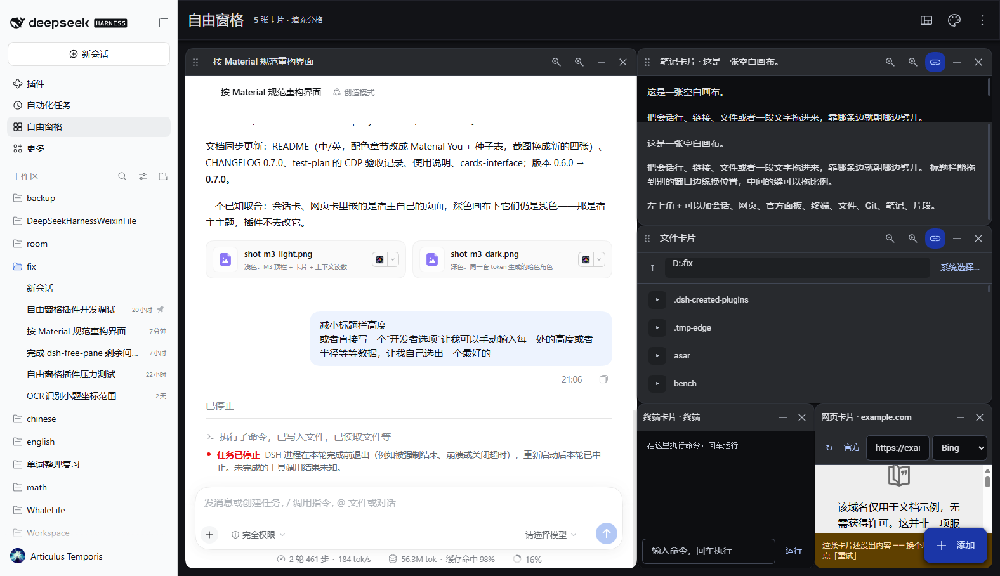
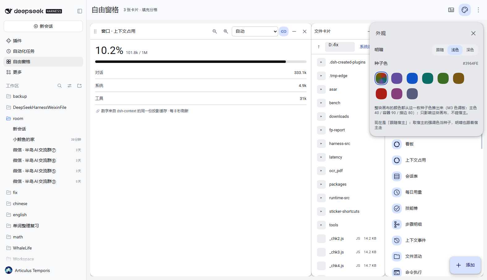
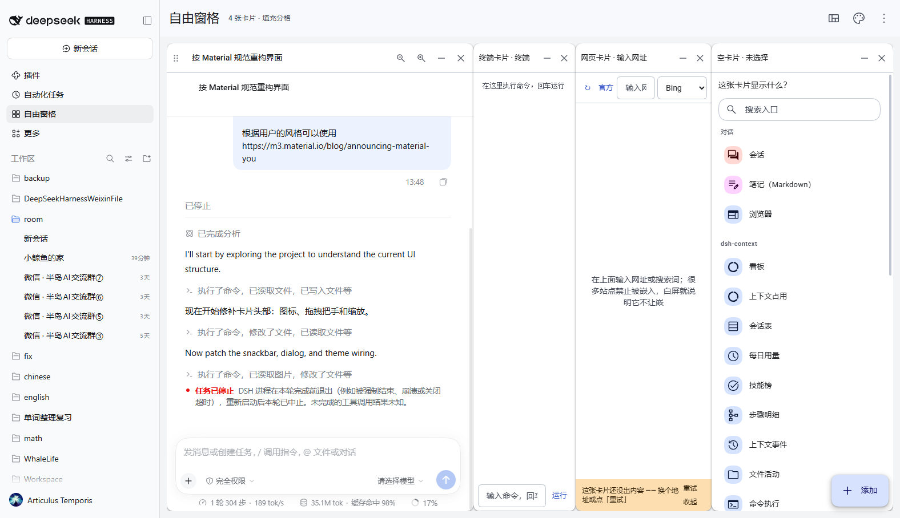
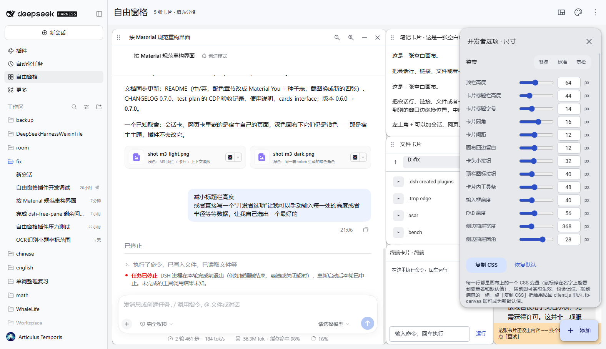

# Free Pane

Turn DeepSeek Harness's main area into a **canvas you can slice however you like**: several conversations, web pages, notes, terminals, folders and Git panels side by side in one window, with positions and sizes you drag yourself.

> Published as a DSH bundle plugin. Half of it runs inside the DSH process (a local reverse proxy plus a few local RPC routes); the other half runs in the renderer (canvas, splitting, dragging). The UI is built on **Material 3** with **Material You** dynamic colour: one seed colour expands into the whole palette.


## What it does

- **An empty canvas, no fixed grid**: the first thing you drop fills the whole area. The next one splits it along the edge your pointer is closest to — left, right, top or bottom — and you can keep splitting.
- **Dividers you can drag**: every divider between two windows is draggable (13%–87%).
- **Move windows anywhere**: drag a title bar onto another window's edge to insert it on that side.
- **Closing merges back**: hit `×` and the neighbours take over the freed space — no holes left behind.
- **Drop anything in**: drag a session from the left list, a link from a page, a file or folder, or plain text — each becomes the matching kind of window.
- **Add in the bottom-right**: click 添加 and pick a kind from the sheet, or drop something straight onto the canvas.
- **The layout is remembered**: stored in `localStorage` per origin, restored after a reload or tab switch.
- **Two places, neither of them on top of the app**: the canvas lives in the main area (click "自由窗格" in the left sidebar), or inside an official sidebar-right tab (`+ → new tab → 自由窗格`). It never covers the whole application, so there is no "nothing responds and nothing closes" state.

## The ten window kinds

| Kind | What it does | Needs |
| --- | --- | --- |
| Session | Embeds a full copy of the DSH UI and opens the given session automatically. **Up to nine session windows can be live at once** — each talks to its own proxy port, so every copy is a separate origin and the browser never squeezes them into one host's connection pool. Windows past the limit get a queue card (title, who is running, and a 「换到这里」 switch button). A cold canvas warms two windows; press 全部挂起 to fill the rest. | the bundled host proxy |
| Web | Opens a URL in a plain `iframe`. Same-origin paths and sites without `X-Frame-Options` work; Bilibili / GitHub / Zhihu and friends are refused by the browser (blank, not a crash). | nothing |
| Note | Markdown on the left, live preview on the right (headings, lists, code blocks, quotes, bold, links). | nothing |
| Region | Capture any piece of the host UI (the billing bar, the usage card) as a window that mirrors it live | same document |
| Terminal | Runs PowerShell commands in the host process and echoes the output. | host |
| Files | Browses directories, click a folder to enter, `↑` to go up. | host |
| Git | Runs `git status --porcelain=v1 -b` against a directory and shows the branch and changes. | host + local git |
| Usage | A data-bridge window: reads the ledger `dsh-bottom-info-bar` already keeps and shows today's spend, today's tokens, this session's tokens and the ledger total. Every number carries a flat 🔗 naming its source; it refreshes every 30 seconds and never touches the network. | host + the bottom info bar plugin |

How to capture: press **Alt+D** (or click 添加 → 抓取), the UI dims, the block under the cursor lights up with its size, and one click turns it into a window. The hotkey can be changed with localStorage['dsh-free-pane.hotkey'] = 'ctrl+shift+g'.

抓取 lists host blocks that already live in their own root: the whale/balance widget, the bottom info bar, the composer, the conversation column, the left sidebar and the right panel. Fixed-size widgets keep their natural size and stay centred; columns fill the width.

A session window decides its source in three steps: what you picked, else the neighbour above-left, else the workspace tree in the window. **Archived sessions are not listed by default**; the 显示归档 (n) link at the top right brings them back, where they are italic, dimmed and marked 已归档.

Without content, a window is an empty dashed placeholder you can use as a drop target.

## Layout presets

The first icon in the top app bar (layout) replaces the whole canvas with one of the ratios real devices use (the session window tries to stay on the session you were already looking at).

| Preset | Ratios | Modelled after |
| --- | --- | --- |
| Apple split 66/33 | main 66%, reference 33% | iPad Split View |
| Stage Manager | stage 72% + two stacked windows on the right | iPadOS Stage Manager |
| Slide over | main 78% + side strip | iPadOS Slide Over |
| Three-column mail | list 22% / body 48% / sidebar 30% | Mail, Outlook |
| Big left + right stack | left 70%, right split in two | Windows 11 Snap 70/30 |
| Quadrants | 2×2 | Mission Control, Win11 2×2, DeX quartering |
| Three equal columns | 1/3 each | Windows 11 three-column Snap |
| Waterfall | two on top, one wide below | Samsung DeX quartering |

## Look and feel: Material 3 + dynamic colour

The canvas is built on **Material 3**: colours, type, shape, elevation and motion all come from one token set, so cards, buttons, menus, sheets and tabs no longer each have their own styling. Icons are Material Symbols (inlined as SVG, no runtime network), and Roboto ships with the bundle.

The second icon in the top app bar (palette) opens 外观:

| Setting | What it does |
| --- | --- |
| Scheme | Follow / light / dark. The canvas is a surface role and cards are surface-container, so dark mode lifts cards one step instead of crushing everything to black |
| Seed | **Material You** dynamic colour: one seed expands into the full tonal curve in OKLCH (primary 40 / container 90 / outline 80 …) and every role is derived from it |

| Seed | Notes |
| --- | --- |
| Follow host | Uses the host accent as the seed and the host's light/dark as the scheme |
| Purple / blue / teal / green / amber / red / pink / graphite | Eight standard seeds; one click repaints the whole canvas (FAB, tabs, bars included) |

It only touches this canvas and never reads or rewrites host colours, so every other page keeps the host's look. Choices persist in `localStorage` (`dsh-free-pane.palette` holds `auto` or a seed id, `dsh-free-pane.scheme` holds light|dark|auto, `dsh-free-pane.preset` the layout). Old skin names (`system-light`, `bauhaus`, `glass` …) map onto the closest seed, so existing users never open an unstyled canvas.

## Developer options: dial the dimensions yourself

Top app bar → ⋯ → 开发者选项（尺寸） lines up every height and corner radius in the UI as a slider; drag one and the canvas follows immediately, so you can find the spacing that suits you:

| Knob | Variable | Default |
| --- | --- | --- |
| App bar height / its icon buttons | `--fp-appbar-h` / `--fp-icon-btn` | 64 / 40 |
| Card title bar height / title size | `--fp-head-h` / `--fp-title-size` | 44 / 14 |
| Card radius / card gap / canvas padding | `--fp-card-r` / `--fp-gap` / `--fp-stage-pad` | 16 / 12 / 12 |
| Card head buttons | `--fp-win-btn` | 32 |
| In-card toolbar / field height | `--fp-bbar-h` / `--fp-field-h` | 48 / 40 |
| FAB height | `--fp-fab-h` | 56 |
| Side sheet width / radius | `--fp-sheet-w` / `--fp-sheet-r` | 368 / 28 |

- **Sets**: 紧凑 / 标准 / 宽松 switch everything at once — pick a base, then fine-tune.
- **Number boxes**: type instead of dragging (Enter or blur commits); values snap to the step (2px, 1px for type, 8px for sheet width) and stay inside their range. The title bar can never become shorter than its own buttons.
- **复制 CSS**: prints the current set as `.fp-canvas{--fp-head-h:44px;…}` — paste it back into `.fp-canvas` in `client.js` to make it the new default. If the browser refuses clipboard access, the CSS opens in a dialog with the text already selected, so `Ctrl+C` still works.
- Values persist in `localStorage['dsh-free-pane.metrics.v1']` (per origin); 恢复默认 restores the built-in set.

## Screenshots

| Light, following the host seed | Dark |
| --- | --- |
|  |  |

| Appearance sheet (Material You seeds) | Picking content for a card |
| --- | --- |
|  |  |

| Developer options: every height and radius |
| --- |
|  |

## Install

DSH desktop → Plugin Manager → install local bundle, pick this directory (`dsh-free-pane/`), then `Ctrl+R` to reload the renderer.

It is a plain bundle: `package.json` declares `dsh.bundle.patch` and `dsh.client`, so any entry point that installs local bundles works.

Two ways to open it afterwards:

1. Click "自由窗格" in the left sidebar — the main area becomes the canvas;
2. Right sidebar `+` → new tab → 自由窗格 — it is inserted as an ordinary tab (and can be expanded to the full column).

## Quick reference

- **Add a window**: 添加 in the bottom-right, or just drop something in.
- **Split**: drop something on a window's left/right/top/bottom edge (a half-height highlight shows the direction), release, and it splits on that side.
- **Change the ratio**: drag the divider between two windows.
- **Move a window**: drag its title bar onto another window's edge.
- **Close a window**: `×` in its title bar.
- **Start over**: 更多 (⋯) in the top app bar → 清空画布.
- **Tune dimensions**: 更多 (⋯) → 开发者选项（尺寸）; drag a slider or type a number, then 复制 CSS when you like the result.
- **Focus**: click a window — its title bar highlights and `+` adds next to it.
- **Right-click**: on a card → rename / split / duplicate / detach / close; on empty canvas → new card / auto-arrange / boot all / clear.
- **Undo**: unpinning 自由窗格 from the sidebar leaves a toast whose Undo re-pins it.
- **Open a file**: click a row in a file window to expand it in place (text or image); `← 返回` / `Esc` goes back, `→ 笔记` hands the text to a note window.
- **Endpoints**: click a chip in a plugin window to read it, `↗ 打开` turns it into a web window, and `同步` re-reads every 2.5 s.

## Known limits

- Every session window is a **full copy of the client** (local proxy + `iframe`), so five or six of them cost real memory. Prefer one session window plus web/note windows.
- Most external sites refuse to be framed: `X-Frame-Options` / `frame-ancestors` is enforced by the browser, and a plugin cannot legimately bypass it.
- Session and web windows run with a `sandbox` that omits `allow-top-navigation`, so the page inside **cannot turn itself into the whole app** — that is deliberate, and it is what prevents "one click on a card replaces the screen".
- Terminal / Files / Git execute inside the host process with the same permissions as DSH itself; there is no extra sandbox.
- The 0.1.0 fixed grid and its full-window overlay were removed (see `CHANGELOG.md`); the pre-0.7.0 skins (graphite / glass / bauhaus / paper) were replaced by Material You seeds, and old palette names map onto the closest seed automatically.

## Compatibility

Developed and tested on **DSH desktop 0.2.2-rc.3 (Windows)**. The plugin only uses public Cordis services (`slots`, `sidebarRightTabs`, `webServer`, `connection`) and theme variables, and imports no Harness internals.

| Capability | Desktop (`dsh-app://`) | Web (`http://127.0.0.1:<port>`) |
| --- | --- | --- |
| Session window | ✅ through the bundled local proxy | ✅ same |
| Web window · external site | ⚠️ still subject to `X-Frame-Options` (no Electron webview) | ⚠️ same |
| Web window · same origin | ✅ | ✅ |
| Note / Terminal / Files / Git | ✅ inside the host process | ✅ same |
| Region | ✅ clone in the same document, clicks forwarded | ✅ same |
| Sidebar-right tab placement | ✅ | ✅ |

- Colours are computed locally: the Material 3 tokens are generated from a seed colour, and "follow host" only reads the host accent and background to pick the seed and the scheme. No other theme variable is required.

## Development

```
dsh-free-pane/
  package.json         bundle metadata (dsh.bundle.patch / dsh.client)
  cordis.patch.yml     inserts the plugin record into the profile
  index.js             host side: webServer routes, session list, directories, commands, git, GUI proxy
  client.js            renderer side: canvas, window tree, splitting, dragging, ten window kinds, M3 components and the colour engine
  locale/{zh,en}.json  title and description shown in Plugin Manager
  icon.svg             four-square icon
```

Host RPC lives under the `/_dsh/dsh-free-pane/` prefix: `listSessions`, `exec`, `listDir`, `statPath`, `gitStatus`, `proxyUrl`, `openInBrowser`, `authUrl`. The renderer calls it with same-origin `fetch`; requests without the session cookie are rejected as 401 by `connection.requestRejection`.

Notes for development:

- **Layout model**: a binary tree stored in `localStorage['dsh-free-pane.tree.v1']`. A leaf is a window (`{id, kind, ...}`), an internal node is a split (`{dir: 'row'|'col', ratio, a, b}`). A drop means "find the target leaf, then replace it with a split of that leaf and the new content".
- After editing `client.js`, reload the plugin (disable then enable in Plugin Manager) to re-deliver it; `index.js` reloads live through `set_bundle enabled=false/true`, no DSH restart needed.
- Once the host is up it writes its proxy port to `%TEMP%\dsh-free-pane-proxy.json`, which is how you tell whether the host half loaded.
- The session list reads `<DSH_HOME>/sessions/**/session.v4.jsonl.zstd`, which is multi-frame zstd; Node's `zstdDecompressSync` only yields the first frame, so the code splits on the `28 B5 2F FD` magic and inflates frame by frame. For speed it only inflates the first 3 frames plus the last 12 (metadata and the session title).
- Debug switches: files are only written with `DSH_FREE_PANE_DEV=1` (except `proxy.json`); `?fpReset=1` clears the layout, `?fpAdd=note,session` adds windows one by one.

## Optional skill: adapt your own plugin (0.9.2)

The package ships `skills/free-pane-plugin-adapter/SKILL.md`. It changes nothing by itself: it inspects an installed plugin read-only, classifies it as a host HTML page, host JSON, right-sidebar panel, client-only widget or conversation artifact, then offers four choices — report only (default), free-pane preset/route only, edit the plugin to add a route or panel, or write a custom card. Nothing is written until you pick one. Install it by copying the folder into `~/.dsh/skills/` or through the skill market's local folder source.

## What this version does (0.10.0)

- **Standard windows.** One `std` JSON contract renders as metrics, table, list or progress; editable JSON, sample data, picker and add-sheet entries.
- **Material naming.** Structural elements carry `data-m3` (`surface`, `top-app-bar`, `card`, `card-header`, `fab`, `side-sheet`, `menu`, `tabs`, `search-picker`); old `.fp-*` classes remain. See `docs/material-naming.md`.
- **Deduplicated.** Chain toggle/context item, `chainOf`/`toggleChain`/`ownerOf` aliases and the second `files` branch are gone.

## What this version does (0.9.1)

- **Pick the conversation yourself.** Usage, context, region and OCR cards get a session dropdown in the header and read only the chosen conversation; positional auto-binding is gone. A fresh session card starts empty and asks for a pick.

## What this version does (0.9.0)

- **Dashboard cards.** A `dash` window takes a plugin route: HTML is embedded, JSON becomes metric tiles, list counts and a key/value table, refreshing every 5 seconds by default. Built-in examples: `/anatomy`, `/anatomy/data.json`, `/taskmonitor/data`. Research notes: [`docs/dashboards.md`](docs/dashboards.md).

## What this version does (0.8.1)

- **Unsupported files point at the host.** Office documents, archives and executables say the DSH right Sidebar's files page previews them, with a button that opens that panel.
- **A session card on the welcome page no longer sits silent.** After eight seconds it explains why no session row was found and asks for a manual pick or Ctrl+K.

## What this version does (0.8.0)

- **File cards browse like a browser.** Every opened file becomes a tab: keep several files in one card, switch between them, close one with ×, and 目录 returns to the listing; 新卡片 copies the current file into its own window; dropping a file onto the canvas opens it in a file card too.
- **PDF, audio, video, images and Markdown render in place.** Markdown has a 源码 / 预览 toggle; Office documents, archives and executables show name, MIME and size with 下载副本 and 系统打开.
- **The address bar opens any path.** Paste a folder to list it, paste a full file path to open it in a tab; folder rows, ↑ and 系统选择… still work.
- **The canvas is 75% of its original size.** 947 px values are scaled down together with the fourteen metrics; embedded host panels and web iframes are laid out at `100/0.75` and zoomed, so they keep filling the card at any size.

## What this version does (0.7.2)

- **Everything is one notch smaller.** All 123 `font-size` declarations in the stylesheet are scaled to 92% and the shipped metrics follow: app bar 64→56, card head 44→36, title 14→13, radius 16→12, gap 12→8, canvas padding 12→8, head buttons 32→28, app-bar icons 40→36, in-card toolbar 48→40, fields 40→36, FAB 56→48, side sheet 368→340 at a 24 px radius. More fits on one screen.
- **Every dimension can be dialed from zero.** All fourteen rows in 开发者选项（尺寸） now start at 0 — title-bar height, buttons, fields, toolbar, FAB, sheet width and radius included — so a card can go down to a bare frame. The stored set moved to `dsh-free-pane.metrics.v2`, so the new defaults apply on the next load instead of being masked by earlier values.
- **Content zoom reaches 50%.** Steps are now 0.5 / 0.6 / 0.7 / 0.8 / 0.9 / 1 / 1.1 / 1.25 / 1.4 / 1.6; two − presses and two + presses still land exactly on 100%.

## What this version does (0.7.1)

- **A developer options sheet.** 更多 (⋯) → 开发者选项（尺寸） exposes thirteen sliders with number boxes for the app bar, card title bar, title size, card radius and gap, canvas padding, card-head buttons, app-bar icon buttons, in-card toolbar, fields, FAB, and the side sheet's width and radius; 紧凑 / 标准 / 宽松 switch the whole set, and 复制 CSS exports the current values as `.fp-canvas{…}`.
- **The card title bar drops from 52 px to 44 px** by default, and heads, app bar, sheets, toolbars, fields and the FAB now take their size from `--fp-*` variables instead of hard-coded numbers.

## What this version does (0.7.0)

- **The whole UI was rebuilt on Material 3.** A token layer — colour roles (primary / container / surface / outline …), the type scale (Roboto 22·16·14·12·11), the shape scale (4 / 8 / 12 / 16 / 28), five elevation levels, state layers and the standard/emphasized easing curves — is derived from one seed colour plus the scheme. Cards, the app bar, buttons, menus, sheets, tabs and fields all consume it instead of carrying their own one-off styling.
- **A Material 3 top app bar** replaces the old chip strip: title plus "N 张卡片 · 填充分格" on the left, three 40dp icon buttons on the right (layout / appearance / more), with motion, boot-all, clear and collapse living in the overflow sheet.
- **An extended FAB replaces the 16px rail.** 添加 opens a side sheet with thirteen entries (empty, session, browser, note, web, terminal, files, Git, plugin endpoints, context, usage, OCR, capture), each with an icon, a name and a one-line hint; capture-any-block still enters pick mode from the same place.
- **The empty-card picker was rewritten**: title, a 48px pill search field that filters as you type (empty groups fold away), and grouped 56dp tonal icon rows instead of nineteen small squares in a blob.
- **Material You dynamic colour replaces the palette presets.** One seed expands into the full tonal curve (OKLCH with a CIE lightness conversion), and light/dark is a separate setting; "follow host" uses the host accent as the seed. The old skins (graphite / glass / bauhaus / paper) are gone and old palette names map onto seeds.
- **Material Symbols for every icon**: 126 official icons inlined as SVG (no runtime network), shared by buttons, menus, card heads, the picker and the empty state; Roboto ships with the bundle, so neither depends on what the machine has installed.
- **Detail work across the board**: 48dp menu rows with an 8% hover layer, 28px-radius dialogs over a 32% scrim, an inverse-surface snackbar, 3px tab indicators, hairline tables with sticky headers, cards lifting one surface step in dark mode, and container queries that drop zoom, link and label buttons as cards narrow.

## What this version does (0.6.0)

- **Every dsh-context table now has a window.** Eight of them: 总览 (sessions, turns, tokens, cost, cache hit, token composition, per-stage timing), 会话 (all 53 sessions, one row each), 每日, 技能, 明细 (every request: turn·step, prompt, cache read, output, ms), 事件, 文件 and 命令. Each window carries its own tab strip, switches tables in place, and names the endpoint plus refresh interval in its footer.
- **One click hands a session from one window to another.** Click a row in 会话 and the window binds to that conversation and jumps to 明细 — from "which conversation is expensive" to "which step paid for it".
- **Windows name themselves after their content**: 看板卡片 · 会话表, a file name, a directory, a site, a note's first line, an endpoint path. Right-click → 重命名… still wins.
- **Cards survive being squeezed**: below 300 px a table turns into 列名 / 值 rows, below 220 px the title bar drops its text buttons, and adding seven cards at once lays them out as an even grid instead of 66 px slivers.
- **Interfaces for the next round**: [`docs/cards-interface.md`](docs/cards-interface.md).

## What this version fixes (0.5.2)

- **No more dead strip beside the conversation.** The host computes its column widths as an inline grid template; hiding the two side columns leaves their tracks in place, so a window (and a full-window conversation) kept a dead strip on the left. The middle column now spans every track, from x=0 to the right edge, in both a card and a standalone window — but only once the conversation is really open (see next bullet).
- **The sidebar is clickable again.** That span rule used to apply as soon as pure mode started, while the sidebar was still there and just covered: a standalone window ignored forty-odd clicks on workspace rows. On top of that the injected stylesheet had two syntax errors (a stray comma, and a doubled `+` that emitted `NaNNaN`), so the whole script failed to parse and not even the style element was inserted. Both fixed; measured in a maximised window: title is the session name, eight message blocks, sidebar `display:none`, conversation from x=0 to 1476.
- **File windows read as a hierarchy.** Directories come first, bold, with `▸`; files show an extension badge and their size; the path is a clickable breadcrumb (`D: › fix › asar`) that jumps to any level.
- **A standalone window no longer sits on the welcome screen.** Its sidebar lists workspaces but no sessions, and the fallback kept clicking the first workspace row, so the target conversation never appeared. It now walks the workspace rows in turn until one lists the session, then opens it.
- **The plugin window tells you what it can really show.** Every endpoint is probed once and 404s are dropped; HTML responses render in an iframe with their own colours and layout; plugins that only ship a host panel and no HTTP page — `context` (the context board) and thirteen more — collapse into one expandable line instead of looking clickable.

## What this version fixes (0.5.1)

- **The composer is back at the bottom of session windows.** Pure mode used to force the host's three-column frame to `display:block`, which threw away the height constraint: the copy grew to its content (a 770 px viewport became 2838 px) and the composer was pushed out of sight, with `html,body{overflow:hidden}` preventing any scroll. The frame keeps `display:grid` now, and only a real grid template is collapsed to one track. Verified in Edge: the composer sits at the bottom, focusable and typable.

## What this version fixes (0.5.0)

- **File windows can actually open files.** A row used to be a drag source only. Clicking one now reads it through the host and renders it in place — text (up to 512 KB), images as base64, binaries refused with a reason — with 返回 / → 笔记 / 系统打开 / 复制路径 in the bar, `Esc` to go back, and the open file remembered on the card.
- **Plugin windows sync and link.** The same input takes a `/_dsh/...` route or a local file path. For routes it adds a full-link row: `↗ 打开` opens it as a web window on the canvas, `复制链接` copies it; `同步` re-reads every 2.5 s and lights a LIVE badge with the last time. Double-clicking a chip does the same.
- **The type picker scrolls** in short windows instead of being clipped at the third row.

## What this version fixes (0.4.1)

- **Session windows no longer stop on the "12 s and still empty" card.** The copy's injected script used a *boot counter* that lived in `sessionStorage`; canvas and iframes share an origin, so after a few loads it gave up on the very first heartbeat — before the host client had even painted a composer — and killed its navigation loop for good. The rule is now time-based (18 s of real waiting), the counter is reset whenever a composer is visible, and giving up is logged as `nav-giveup`. A normal load still lands in the conversation in 3–5 s.
- **Right-click menus.** On a card: rename, switch to another session, split left/right/top/bottom, duplicate to the right, detach the data source, close. On empty canvas: new session/note/browser/empty card, auto-arrange, boot all, toggle free/fill, clear canvas. `Esc` or a click elsewhere dismisses.
- **Drop targets are visible.** While dragging, the target card shows which side it will take and how much, with a dashed outline; dragging a title bar looks through the shield to the card underneath.
- **Undo for "unpin from sidebar".** Unpinning 自由窗格 now leaves a toast with an Undo button that re-pins it for you through the host's "更多" (More) menu.
- **Title picker popover is exactly 260 px**: it is rendered from the card root with an inline width instead of fighting the header's flex, and flips above the button when there is no room below.
- **One embedded form for session cards** — the card only ever shows the conversation column, never a full client with a second sidebar.

## License

MIT
